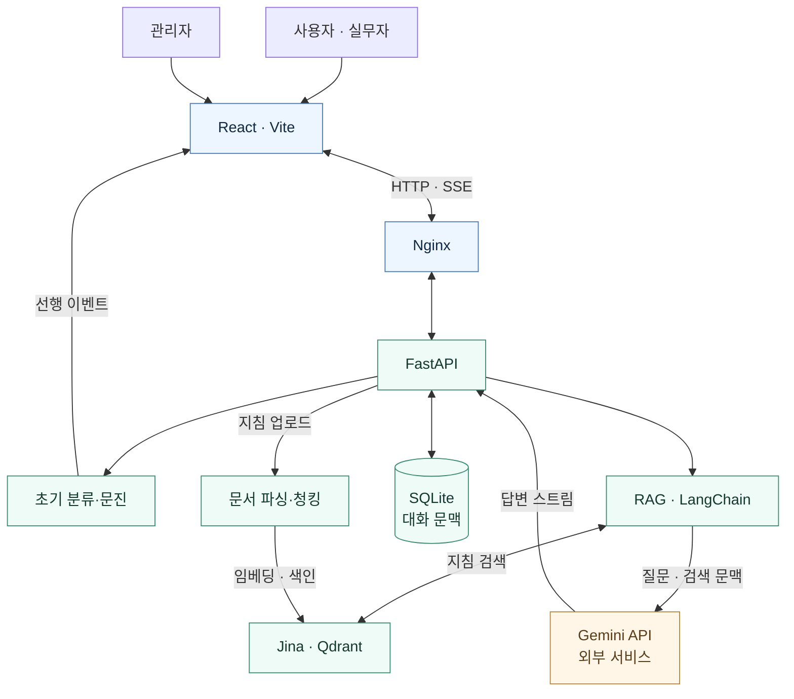

# 법정감염병 지침 검색 · 임상 의사결정 참고 시스템

**2026-2 국립부경대학교 AI 부트캠프 · BootCampEW**

`React` · `FastAPI` · `LangChain` · `Jina Embeddings` · `Qdrant` · `Gemini`

[프로젝트 소개](#프로젝트-소개) · [주요 기능](#주요-기능) · [아키텍처](#시스템-아키텍처) · [저장소](#코드-저장소) · [문서](#문서-구조) · [로드맵](#향후-과제)

---

## 프로젝트 소개

**Infection QA**는 법정감염병과 감염관리 지침을 검색하고, 질문의 문맥과 검색 근거를 결합해 답변을 제공하는 웹 애플리케이션입니다. 범용 감염병 챗봇에서 출발해 의료·방역 실무자의 지침 확인과 정보 탐색을 지원하는 **CDSS(Clinical Decision Support System) 참고 도구**로 발전하고 있습니다.

지침 문서를 검색하는 RAG(Retrieval-Augmented Generation)와 초기 분류 안내를 결합해, 사용자가 관련 정보와 추가 확인 항목을 함께 살펴볼 수 있도록 설계했습니다.

> **의료적 참고를 위한 개발 프로젝트입니다.** 확정 진단·처방이나 의료진의 최종 판단을 대체하지 않습니다. 질문에 환자·개인을 식별할 수 있는 정보를 입력하지 마세요.

## 주요 기능

| 기능 | 제공 내용 |
| :--- | :--- |
| **지침 기반 질의응답** | 로컬 Jina 임베딩과 Qdrant로 관련 지침을 검색하고, Gemini로 문맥을 반영한 답변 생성 |
| **두 단계 응답** | 규칙 기반 초기 triage·문진 안내를 먼저 전달한 뒤, 상세 답변을 SSE로 스트리밍 |
| **지침 최신성 관리** | 문서 연도에 따른 검색 범위 필터와 최신 지침 우선 정렬, 반영 기준 조회 |
| **대화 문맥 유지** | 세션별 최근 대화 활용 및 사용자 대화 초기화 |
| **관리자 지침 관리** | 인증된 관리자의 PDF·HWPX·TXT·MD 업로드, 색인 반영 및 처리 이력 조회 |
| **상태 확인과 설정** | 모델·검색 엔진 상태 조회와 허용된 답변 모델 설정 변경 |

기능은 현재 소스 기준으로 정리했습니다. 초기 triage는 키워드 규칙에 따른 참고 정보이며, 임상적으로 검증된 진단·응급도 판정으로 해석해서는 안 됩니다.

## 시스템 아키텍처

**질문 흐름:** 초기 분류 안내 → 지침 검색 → 최근 대화와 검색 근거를 반영한 답변 생성 → 스트리밍 전달.

**지침 반영 흐름:** 관리자 업로드 → 파일 검증·파싱·청킹 → 로컬 임베딩 → Qdrant 색인 → 반영 이력 기록.

임베딩·검색·대화 저장은 로컬 구성에서 수행하며, 답변 생성에는 외부 Gemini API를 사용합니다. 위 그림은 논리적 구성도입니다.

## 기술 스택

| 영역 | 기술 |
| :--- | :--- |
| **Frontend** | JavaScript, React, Vite, React Router, React Markdown |
| **Backend** | Python, FastAPI, Uvicorn, Pydantic |
| **검색·AI** | LangChain, Jina Embeddings, Sentence Transformers, PyTorch, Qdrant, Gemini API |
| **데이터·문서** | SQLite, JSON, PDF·HWPX·TXT·Markdown 처리 |
| **실행·품질 관리** | Docker Compose, Nginx, pytest, GitHub Actions |

## 코드 저장소

| 저장소 | 역할 | 공개 범위 |
| :--- | :--- | :--- |
| [**frontend**](https://github.com/BootCampEW/frontend) | React 사용자·관리자 화면, API 연동 및 스트리밍 표시 | Private |
| [**backend**](https://github.com/BootCampEW/backend) | FastAPI, RAG, 지침 처리, 대화·이력 서비스 및 테스트 | Private |
| [**.github**](https://github.com/BootCampEW/.github) | 공개 조직 프로필과 소개 자산 | Public |

소스 저장소와 내부 문서는 접근 권한이 있는 구성원만 열람할 수 있습니다. 이 페이지는 프로젝트의 목적과 구조를 소개하는 공개 문서입니다.

## 문서 구조

**제품 정의 → 요구사항 → 아키텍처 → API → 운영** 순서로 읽는 것을 권장합니다. 아래 링크는 비공개 `backend` 저장소의 현재 문서로 연결됩니다.

| 문서 | 내용 |
| :--- | :--- |
| [PRD.md](https://github.com/BootCampEW/backend/blob/main/docs/PRD.md) | 목적, 사용자, 제공 범위와 인수 기준 |
| [REQUIREMENTS.md](https://github.com/BootCampEW/backend/blob/main/docs/REQUIREMENTS.md) | 기능·비기능 요구사항과 확인 방법 |
| [APP_ARCHITECTURE.md](https://github.com/BootCampEW/backend/blob/main/docs/APP_ARCHITECTURE.md) | 컴포넌트 책임과 데이터 흐름 |
| [API_SPEC.md](https://github.com/BootCampEW/backend/blob/main/docs/API_SPEC.md) | 요청·응답과 SSE 계약 |
| OPERATIONS.md | 구성원용 실행·유지보수 안내 |
| docs-manifest.json | 문서 변경 검증 기준 |

별도 보관된 개발 자료에는 **RAG·임베딩 모델 연구, CDSS 전환 전략, 라우터·배포 경계 가이드, API 설계 학습, 날짜별 작업 기록**이 있습니다. 공개 프로필에는 이 자료들의 목적과 개발 흐름을 요약했습니다.

최신 제품·API 문서와 실제 코드를 현재 구현의 기준으로 사용하며, 과거 연구의 모델·성능 수치나 배포 구성은 현행 동작을 보장하는 근거로 사용하지 않습니다.

## 개발 이력

| 시기 | 주요 변화 |
| :--- | :--- |
| **초기 설계·연구** | 지침 기반 챗봇 설계, 벡터 검색과 임베딩 모델 비교, Qdrant·Gemini 활용 검토 |
| **2026.09** | CDSS 참고 도구 방향 구체화, 초기 분류와 상세 답변을 나누는 두 단계 응답, 지침 업로드 반영 기능 개발 |
| **2026.10 초** | 사용자·관리자 라우터와 RAG·서비스 계층 분리, 지침 최신성·반영 이력·대화 문맥 관리 보완 |
| **2026.10.16** | FE/BE 책임과 API 경계, 로컬 실행 및 검증 절차 정리 |
| **2026.10.17** | React 화면과 FastAPI 코드의 저장소 반영, 화면·API 계약 점검 및 후속 과제 정리 |

## 향후 과제

- **검색과 답변 품질:** 감염병 질문 평가셋을 구성하고, 근거 적합성·최신성·불확실성 표현을 검증합니다.
- **분류 안내의 의미:** 법정감염병 분류와 응급도를 구분하고, 초기 카드와 상세 답변의 일관성을 점검합니다.
- **화면·API 계약:** 지침 상태, 빠른 선택 목록, 관리자 응답 필드와 빈 결과·취소·오류 표시를 지속적으로 검증합니다.
- **데이터 신뢰성:** 테스트 데이터와 실제 지침 이력을 분리하고, 원문·메타데이터·색인의 일치 검증을 강화합니다.
- **재현 가능한 개발:** 계약·인증·업로드·세션 보존 테스트와 화면 검증을 보완하고, 문서와 코드의 변경을 함께 관리합니다.

---

**BootCampEW · Infection QA**  
지침을 찾고, 근거를 확인하고, 전문가의 판단을 지원합니다.

프로젝트 소개 기준: 2026-10-17

