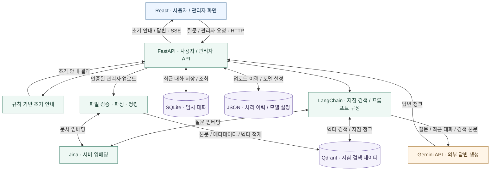

# Infection QA
### 법정감염병 지침 검색 · 정보 안내 서비스

**2026-2 국립부경대학교 AI 부트캠프 · BootCampEW**

**[서비스 열기 · Visit Website](https://outboard-retrieval-aqueduct.ngrok-free.dev/)**

`React` · `FastAPI` · `LangChain` · `Jina Embeddings` · `Qdrant` · `SQLite` · `Gemini`

[프로젝트 소개](#프로젝트-소개) · [주요 기능](#주요-기능) · [시스템 아키텍처](#시스템-아키텍처) · [기술 스택](#기술-스택) · [팀 구성](#팀-구성) · [저장소와 문서](#저장소와-문서) · [향후 과제](#향후-과제)

## 프로젝트 소개

본 프로젝트는 **[부산광역시 감염병관리지원단](https://www.busancidc.or.kr/)**의 의뢰를 받아 제작되었습니다.

**Infection QA**는 법정감염병과 감염관리 지침을 검색하고, 사용자의 질문에 맞춰 관련 정보를 안내하는 웹 서비스입니다. 지침 검색에 RAG(Retrieval-Augmented Generation)를 활용하며, 최근 대화 문맥을 반영한 후속 질문과 관리자 지침 업로드를 지원합니다.

> 감염병 정보를 알려주는 참고 서비스입니다. 진단·처방이나 의료진의 판단을 대신하지 않습니다. 질문에는 개인을 식별할 수 있는 정보를 입력하지 마세요.

## 서비스 이용

**[https://outboard-retrieval-aqueduct.ngrok-free.dev/](https://outboard-retrieval-aqueduct.ngrok-free.dev/)**

처음 접속할 때 ngrok 안내 화면이 나타나면 **Visit Site**를 선택하면 됩니다. ngrok 터널과 서비스가 실행 중일 때 이용할 수 있습니다.

## 주요 기능

| 기능 | 구현 내용 |
| :--- | :--- |
| **지침 기반 정보 안내** | Jina 임베딩과 Qdrant로 관련 지침을 검색하고 Gemini로 답변 생성 |
| **단계별 응답** | 규칙 기반 초기 안내를 먼저 전달하고, 상세 답변을 SSE로 스트리밍 |
| **대화 문맥 활용** | SQLite에 저장된 세션별 최근 질문·답변을 후속 질문에 반영하고 대화 초기화 지원 |
| **지침 업로드** | 관리자 인증 후 PDF·HWPX·TXT·Markdown 파일을 검증·파싱·청킹하고 색인에 반영 |
| **지침·설정 관리** | 업로드 처리 이력·모델 설정을 JSON으로 저장하고, 처리 이력 조회와 허용된 답변 모델 설정 변경 지원 |
| **연도 조건 검색** | 문서의 연도 정보를 이용해 검색에 사용할 지침 범위 제한 |

초기 안내는 코드에 정의된 질환·키워드 규칙을 사용합니다. 상세 답변은 검색된 지침 본문과 질문 문맥을 이용해 생성합니다.

## 시스템 아키텍처

아래는 **현재 저장소 코드에서 확인한 구성 요소와 데이터 흐름**입니다.

**질문 처리:** 질문과 최근 대화 조회 → 규칙 기반 초기 안내 → 지침 검색 → 프롬프트 구성 → Gemini 답변 생성 → SSE 전달 → 정상 완료된 대화 저장.

**지침 반영:** 관리자 인증 → 업로드 파일 검증 → 파싱·청킹 → Jina 임베딩 → Qdrant 적재 → JSON 처리 이력 기록 → 임시 파일 정리.

| 구성 | 역할 |
| :--- | :--- |
| **React** | 사용자 질문·답변 화면과 관리자 화면, API 호출·스트리밍 표시 |
| **FastAPI** | 사용자·관리자 요청 처리, 초기 안내와 검색·생성 흐름 연결 |
| **Jina** | 백엔드 서버에서 질문·지침 텍스트를 벡터로 변환 |
| **Qdrant** | 지침 청크의 본문·메타데이터·벡터 저장과 검색 |
| **SQLite** | 세션별 임시 대화 저장과 최근 문맥 조회 |
| **JSON** | 업로드 처리 이력과 관리자 모델 설정 저장 |
| **Gemini API** | 질문·최근 대화·검색된 지침 본문을 받아 외부에서 답변 생성 |
| **ngrok** | 위 서비스 주소를 통한 외부 HTTPS 접속 경로 |

Qdrant와 SQLite는 용도가 다른 저장소이며 함께 사용합니다. 대화의 기본 보존 기간은 24시간으로 설정되어 있고 만료 기록을 정리합니다. 답변 생성에 필요한 질문·최근 대화·검색 본문은 외부 Gemini API에 전달됩니다.

구성도는 컴포넌트 사이의 논리적 관계를 나타냅니다. 특정 장비·내부 주소·포트·프록시 배치를 가정한 배포도는 아닙니다.

## 기술 스택

| 영역 | 기술 |
| :--- | :--- |
| **화면** | JavaScript, React, Vite, React Router, React Markdown |
| **API** | Python, FastAPI, Uvicorn, Pydantic, SSE |
| **검색·임베딩** | LangChain, Jina Embeddings, Sentence Transformers, PyTorch, Qdrant |
| **대화·설정·이력** | SQLite, JSON |
| **답변 생성** | Gemini API |
| **접속·실행 구성** | ngrok, Docker Compose·Nginx 구성 파일 |
| **검증 도구** | pytest, GitHub Actions |

## 팀 구성

| 역할 | 담당 |
| :--- | :--- |
| **Backend (BE)** | 김지우, 장재원 |
| **Frontend (FE)** | 라현준, 전서영 |
| **Project Manager (PM)** | 장재원 |
| **멘토** | 홍성석 |

## 저장소와 문서

| 저장소 | 책임 | 공개 범위 |
| :--- | :--- | :--- |
| [**frontend**](https://github.com/BootCampEW/frontend) | React 사용자·관리자 화면과 API·SSE 연동 | Private |
| [**backend**](https://github.com/BootCampEW/backend) | FastAPI, RAG, 지침 처리, 대화·설정·이력 서비스 | Private |
| [**.github**](https://github.com/BootCampEW/.github) | 공개 조직 프로필과 소개 자산 | Public |

소스와 내부 문서는 접근 권한이 있는 구성원만 열람할 수 있습니다.

| 문서 | 내용 |
| :--- | :--- |
| [PRD.md](https://github.com/BootCampEW/backend/blob/main/docs/PRD.md) | 프로젝트 목적·사용자·제공 범위 |
| [REQUIREMENTS.md](https://github.com/BootCampEW/backend/blob/main/docs/REQUIREMENTS.md) | 기능·비기능 요구사항 |
| [APP_ARCHITECTURE.md](https://github.com/BootCampEW/backend/blob/main/docs/APP_ARCHITECTURE.md) | 내부 애플리케이션 구조 문서 |
| [API_SPEC.md](https://github.com/BootCampEW/backend/blob/main/docs/API_SPEC.md) | 요청·응답과 SSE 계약 |
| OPERATIONS.md | 구성원용 실행·운영 안내 |
| docs-manifest.json | 문서 해시 목록 |

이 페이지의 아키텍처는 현재 `frontend`·`backend` 코드에 대조해 작성한 공개 소개입니다. 내부 문서에는 제품·요구사항·API·운영에 관한 상세 개발 자료가 있습니다.

## 개발 이력

| 시점 | 확인한 내용 |
| :--- | :--- |
| **2026.10.17** | frontend의 React 화면과 backend의 FastAPI·RAG·서비스 코드가 main에 반영 |
| **2026.10.18** | 공개 프로필의 시스템 아키텍처·저장소별 역할·기술 스택을 재정리하고 서비스 링크 추가 |

## 향후 과제

- **안내 품질:** 검색 결과와 생성 답변이 지침 내용에 맞는지 평가하고 질문·오류 사례를 정리합니다.
- **출처 연결:** 답변에 사용한 원문·페이지·개정 정보를 사용자가 확인할 수 있도록 보완합니다.
- **데이터 정합성:** 업로드 처리 이력과 실제 Qdrant 색인의 일치를 확인합니다.
- **문서 정비:** 분리 저장소 기준으로 실행 경로·배포 설명·API 문서를 맞춥니다.
- **공개 준비:** 소스 공개 전 파일·Git 이력과 자료·모델·표시물의 재사용 조건을 검토합니다.

---

**BootCampEW · Infection QA**  
지침을 검색하고, 감염병 정보를 안내합니다.

소개 기준: 2026-10-18 · 현재 저장소 코드 및 서비스 화면 확인

